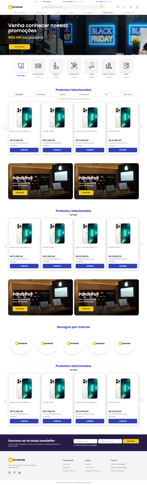

# Econverse Store

Projeto de uma loja feito com React, TypeScript e Sass, usando Vite. O layout segue o Figma do teste e os produtos vêm do JSON da Econverse.



## Como rodar

Use Node.js 22.12 ou superior e npm.

```sh
npm ci
npm run dev
```

O Vite mostra o endereço no terminal, normalmente `http://127.0.0.1:5173`.
É preciso ter internet para buscar os produtos e carregar as fotos.

Para gerar e rodar o build:

```sh
npm run build
npm start
```

O servidor abre em `http://127.0.0.1:3000`.

## O que funciona

- Busca pelo nome do produto, ao clicar na lupa ou apertar Enter. Limpar o campo mostra os produtos de novo.
- Carrossel com setas. Nas vitrines sem filtros, “Ver todos” abre os produtos em uma grade.
- Modal com os dados do produto, seleção de quantidade e fechamento com Escape ou clique fora.
- Contador do carrinho ao comprar pelo modal.
- Layout adaptado para desktop e celular.
- Cartões de carregamento, botão para tentar novamente se a busca falhar e uma imagem alternativa para fotos que não carregam.

## Algumas decisões

A API não permite a chamada direta pelo navegador por causa do CORS. Por isso, a aplicação chama `/api/products`: o Vite faz o proxy no desenvolvimento e o `server.mjs` faz isso no build. Se a página for hospedada em outro lugar, essa rota também precisa ser configurada; só enviar a pasta `dist` não é suficiente.

O JSON só tem celulares. Os filtros das outras categorias mostram um aviso e um botão para voltar. As categorias ilustrativas estão marcadas com “Em breve”.

O JSON também não tem preço anterior, então não coloquei um preço riscado inventado. O preço é exibido como vem da API, em reais, e a parcela é calculada dividindo esse valor por dois.

O carrinho guarda apenas a quantidade em memória e reinicia ao atualizar a página. Não tem checkout. A newsletter valida os campos, mas não envia os dados. Conta, favoritos e os demais atalhos sem integração são demonstrativos.

## Organização

```text
src/
  components/   Partes da página e modal
  hooks/        Carregamento dos produtos
  services/     Chamada da API e formatação de preço
  styles/       Estilos e cores
  types.ts      Tipo do produto
  App.tsx       Montagem da página
public/assets/  Imagens e ícones
tests/         Testes
server.mjs      Servidor para rodar o build e o proxy
```

## Testes e formatação

```sh
npm test
npm run lint
npm run format:check
npm run build
```

Os testes cobrem os dados da API, busca, filtros, carregamento, imagem alternativa e interações do modal. Para aplicar a formatação, use `npm run format`.

Também há testes com Playwright para o modal, o carrinho, o layout no celular e as setas do carrossel:

```sh
npx playwright install chromium
npm run test:e2e
```


## Referências

- [Layout no Figma](https://www.figma.com/design/UdBnVKDgcpURIpf0Tcmfeb/Untitled?node-id=0-18)
- [JSON dos produtos](https://app.econverse.com.br/teste-front-end/junior/tecnologia/lista-produtos/produtos.json)
